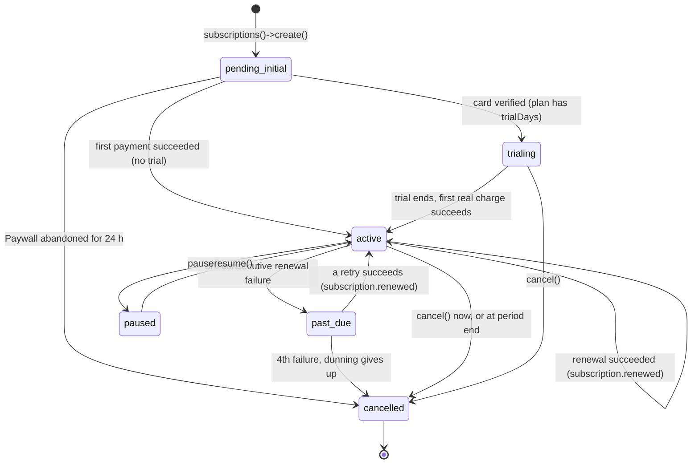

# Aslan Payment for Laravel

Laravel integration for the official Aslan PHP SDK, [`aslan/payment-php`](https://github.com/Belkouche/aslan-payment-php-symfony): accept card payments, bill customers on a recurring basis (subscriptions), and receive signed webhooks as ordinary Laravel events.

- Package: `aslan/payment-laravel` (version **0.2.0**), built on `aslan/payment-php` **0.2.x**
- API base URL: `https://api.aslanpay.ma/pay`
- Laravel 12 and 13
- Writing code with an AI coding agent? Jump to [For LLM coding agents](#12-for-llm-coding-agents) (also see [`AGENTS.md`](AGENTS.md) and [`llms.txt`](llms.txt)).

## Table of contents

1. [What this is and who it is for](#1-what-this-is-and-who-it-is-for)
2. [Requirements, and why this PHP version?](#2-requirements-and-why-this-php-version)
3. [Installation](#3-installation)
4. [Concepts in 2 minutes](#4-concepts-in-2-minutes)
5. [Quick start: a one-time payment](#5-quick-start-a-one-time-payment)
6. [Subscriptions, step by step](#6-subscriptions-step-by-step)
7. [Webhooks in depth](#7-webhooks-in-depth)
8. [Errors](#8-errors)
9. [Testing your application](#9-testing-your-application)
10. [Configuration reference](#10-configuration-reference)
11. [Events reference](#11-events-reference)
12. [For LLM coding agents](#12-for-llm-coding-agents)
13. [Security checklist](#13-security-checklist)
14. [Upgrading](#14-upgrading)
15. [License](#15-license)

---

## 1. What this is and who it is for

You run a Laravel application and want to get paid in Morocco (MAD). Aslan hosts the payment pages and talks to the card networks; your code never sees a card number. This package wires the SDK into Laravel so you do not have to:

| You get | So that you can |
|---|---|
| A container-bound `Aslan\Payment\Aslan` client built from `.env` | inject it, or call it through the `Aslan` facade |
| The `Aslan` facade (`Aslan::checkoutSessions()`, `Aslan::subscriptions()`, ...) | call any SDK resource in one line |
| `Aslan::paywall($checkout)` | send a customer to the subscription Paywall correctly (it needs a form POST, not a redirect) |
| A webhook route that verifies signatures | trust what arrives, with zero code |
| One Laravel event per webhook (`SubscriptionRenewed`, `PaymentSucceeded`, ...) | react with normal (queued) listeners |

What it deliberately does **not** ship: models, migrations, or a billing UI. You store the few IDs you need in your own tables (examples below).

Everything the SDK returns is a typed, read-only object (`CheckoutSession`, `Subscription`, ...). The facade does not wrap or change those results, so the [SDK README](https://github.com/Belkouche/aslan-payment-php-symfony) is the reference for every DTO property.

---

## 2. Requirements, and why this PHP version?

| Requirement | Constraint |
|---|---|
| PHP | `~8.2.35 \|\| ~8.3.36 \|\| ~8.4.27 \|\| >=8.5.12` |
| Laravel | 12.x (PHP 8.2+) or 13.x (PHP 8.3+, released March 2026) |
| `aslan/payment-php` | `^0.2` (installed automatically) |

Laravel 13 itself needs PHP 8.3 or newer, so on PHP 8.2 Composer picks Laravel 12. Both are supported by this package with the same code.

### Why this PHP version? (read this, it is short)

On **2026-10-21** the PHP project released **8.5.12, 8.4.27, 8.3.36 and 8.2.35**. These releases fix two critical, unauthenticated **remote code execution** (RCE) flaws:

- **CVE-2026-109618**: out-of-memory corruption
- **CVE-2026-109619**: stale global state

Together they are nicknamed **"php2shell"** (CVSS v4 score 9.2, i.e. "critical"). They were publicly disclosed *before* the fix existed, so attackers had a head start. "Unauthenticated RCE" means a stranger on the internet can make your server run code of their choosing, without logging in.

A payment integration holds the keys to money: your API secret key (`ASLAN_API_KEY`) and your webhook secret (`ASLAN_WEBHOOK_SECRET`) live on that server. An attacker who runs code there can read both. So this package takes a firm stance: **it refuses to install on a PHP version that is vulnerable.**

Sources:

- [PHP release announcement](https://news-web.php.net/php.announce/509)
- [PHP supported versions](https://www.php.net/supported-versions.php)
- [Help Net Security coverage](https://www.helpnetsecurity.com/2026/10/21/php2shell-php-vulnerabilities-patched-cve-2026-109618-cve-2026-109619/)

#### How to read the constraint

`~8.3.36` means "8.3.36 **or later 8.3.x**, but not 8.4". The four alternatives are OR-ed together, one per supported PHP line:

| Your PHP line | Minimum accepted version |
|---|---|
| 8.2.x | 8.2.35 |
| 8.3.x | 8.3.36 |
| 8.4.x | 8.4.27 |
| 8.5.x and later | 8.5.12 |
| 8.1 or older | not supported (also end-of-life) |

#### What Composer does about it

- `composer require` / `composer install` **refuses to install** the package on a vulnerable PHP and tells you which platform requirement failed. Do not work around it with `--ignore-platform-req=php` or a fake `config.platform.php`: upgrade PHP.
- Composer also generates a runtime `platform_check` in `vendor/composer/`, but it only enforces the **lowest bound (8.2.35)**, not the per-line floors. A server running 8.4.20 would pass that runtime check. Do not rely on it: **keep the PHP that actually serves your site patched**, not just the one that ran `composer install` on a build machine.

#### Check and upgrade your PHP

```bash
php -v                       # e.g. "PHP 8.4.27 (cli) ..." -> OK;  "PHP 8.4.25" -> too old
php-fpm -v                   # the web PHP can differ from the CLI PHP
composer check-platform-reqs
```

| Where you run Laravel | How to upgrade |
|---|---|
| Laravel Forge | Server > PHP: install the patched version (or "Patch Version"), then switch the site to it |
| Laravel Vapor | Use a patched runtime / Docker base image in `vapor.yml`, then redeploy |
| Docker | Pin a patched official tag, e.g. `FROM php:8.4.27-fpm` (or `php:8.5.12-fpm`), rebuild and redeploy |
| Plain server | Your distribution's security update or PPA, then restart PHP-FPM and your queue workers |

Restart long-running processes (PHP-FPM, `queue:work`, Horizon, Octane) after upgrading: they keep the old binary in memory.

**Interim mitigation (only if you cannot upgrade immediately):** set `session.upload_progress.enabled=0` in `php.ini`. This blocks the *known* exploitation paths of the second flaw (CVE-2026-109619) only. It does **not** cover the first flaw nor all variants, and does not replace upgrading.

#### End of life for PHP 8.2

PHP 8.2 reaches **end of life on 2026-12-31**; after that it gets no security fixes. New projects should use **PHP 8.4 or 8.5** (with Laravel 13).

---

## 3. Installation

### 3.1 Require the package

```bash
composer require aslan/payment-laravel
```

**If the packages are not on Packagist yet**, install them straight from GitHub. Composer only reads `repositories` from your *root* `composer.json` (never from dependencies), so you must list **both** the Laravel package and the SDK it depends on:

```json
{
    "repositories": [
        { "type": "vcs", "url": "https://github.com/Belkouche/aslan-payment-laravel" },
        { "type": "vcs", "url": "https://github.com/Belkouche/aslan-payment-php-symfony" }
    ]
}
```

```bash
composer require aslan/payment-laravel
```

If those repositories have no release tag yet, require the branches explicitly (the alias makes the SDK branch satisfy `^0.2`):

```bash
composer require "aslan/payment-php:dev-main as 0.2.0" "aslan/payment-laravel:dev-main"
```

> **About the `path` repository in this package's `composer.json`:** it points at a local checkout of the SDK and exists only for developing *this package*. Composer ignores it when the package is installed as a dependency of your app, so it has no effect on you.

The service provider (`Aslan\Laravel\AslanServiceProvider`) and the `Aslan` facade alias are **auto-discovered**; there is nothing to register.

### 3.2 Publish the config (optional)

```bash
php artisan vendor:publish --tag=aslan-config
```

This copies `config/aslan.php` into your app. You only need it to change defaults that have no environment variable; everything else is driven by `.env`.

### 3.3 Set your environment

```dotenv
ASLAN_API_KEY=sk_test_<prefix>_<secret>
ASLAN_WEBHOOK_SECRET=whsec_xxxxxxxxxxxxxxxxxxxxxxxx
```

- `ASLAN_API_KEY`: your **secret** key. `sk_test_...` = test mode, `sk_live_...` = live mode.
- `ASLAN_WEBHOOK_SECRET`: the signing secret of your webhook endpoint (shown once, when you create the endpoint in the dashboard or with `Aslan::webhooksConfig()->create(...)`).

The client is built lazily, the first time it is used. If `ASLAN_API_KEY` is empty, resolving it throws `Aslan\Laravel\Exceptions\MissingApiKeyException`, but the application still boots, so `artisan` commands keep working on machines without credentials.

After changing `.env` in production, run `php artisan config:cache` again.

### 3.4 The webhook route

The package registers this route for you:

```
POST /aslan/webhook      name: aslan.webhook      middleware group: api
```

Give its **full HTTPS URL** (e.g. `https://shop.example/aslan/webhook`) to Aslan as your webhook URL, from the dashboard or once from `php artisan tinker`:

```php
$config = \Aslan\Laravel\Facades\Aslan::webhooksConfig()->create(['url' => 'https://shop.example/aslan/webhook']);
$config->signingSecret;   // put it in ASLAN_WEBHOOK_SECRET now; it is only returned here
```

Check it is registered with `php artisan route:list --name=aslan`. If you cache routes (`route:cache`), the route is included in the cache like any other.

### 3.5 CSRF: nothing to do (unless you change the middleware)

Aslan's servers cannot send a CSRF token, and they do not need to: every delivery is authenticated by its HMAC signature instead. That is why the route lives in the `api` group, **outside** `web` (no session, no CSRF). Do not move it behind `web`, `auth`, or `verified`.

If you really must use the `web` group (`ASLAN_WEBHOOK_MIDDLEWARE=web`), exclude the path from CSRF in `bootstrap/app.php`:

```php
->withMiddleware(function (Middleware $middleware) {
    $middleware->validateCsrfTokens(except: ['aslan/webhook']);
})
```

If your `api` group has a strict `throttle`, bursts of deliveries can get a `429` (Aslan will retry). Set `ASLAN_WEBHOOK_MIDDLEWARE=` (empty) to register the route with no group middleware at all; the signature check still runs.

### 3.6 Queue your listeners

Webhook listeners run inside the webhook request unless you queue them. Aslan waits about 10 seconds for your answer and treats anything slower, or any non-2xx, as a failure to retry. So make listeners that touch the database, send e-mails, or call APIs implement `ShouldQueue`, and run a worker:

```bash
php artisan queue:work
```

(`QUEUE_CONNECTION=sync` would run them inline again; use `database`, `redis`, or SQS in production.)

---

## 4. Concepts in 2 minutes

### Keys and modes

The facade and the client authenticate with your secret key (`Authorization: Bearer sk_...`, done for you). **Test or live mode is decided only by the key prefix**:

| Prefix | Mode | Money moves? |
|---|---|---|
| `sk_test_...` | test | No. Safe for development |
| `sk_live_...` | live | Yes. Real customers, real money |

There is no mode flag. `Aslan::isTestMode()` / `Aslan::isLiveMode()` tell you which one you are using.

### Amounts are integers in centimes

All amounts are **integers in centimes** (1/100 of a dirham), currency **MAD**.

| You want to charge | You send |
|---|---|
| 149.00 MAD | `14900` |
| 50.00 MAD | `5000` |
| 0.50 MAD | `50` |

Never send floats (`149.0`) or strings (`"149.00"`). Store money as integer centimes in your database too, and convert once at the edge: `(int) round($priceInMad * 100)`.

### Two ways to call the API

```php
use Aslan\Laravel\Facades\Aslan;

Aslan::subscriptions()->retrieve($id);   // facade: method name = SDK property name
```

```php
use Aslan\Payment\Aslan;

public function __construct(private Aslan $aslan) {}   // injection: the same singleton
$this->aslan->subscriptions->retrieve($id);
```

Every SDK resource property is a facade method of the same name: `checkoutSessions()`, `transactions()`, `paymentLinks()`, `refunds()`, `vendors()`, `customers()`, `apiKeys()`, `webhooksConfig()`, `plans()`, `subscriptions()`, `billingAttempts()`, `invoices()`. Client methods are forwarded too (`isTestMode()`, `getBaseUrl()`), and `Aslan::client()` returns the `Aslan\Payment\Aslan` instance itself.

### Checkout session vs subscription

- **Checkout session**: a single-use, time-limited payment for one order. Redirect the customer to `$session->url` (a normal redirect).
- **Subscription**: the customer saves a card once on the hosted **Paywall**, then pays a **plan** automatically every period. The Paywall needs a **form POST**: return `Aslan::paywall($checkout)`, never `redirect($checkout->redirectUrl)`.

### Webhooks are the source of truth

When the customer comes back to your `successUrl` / `returnUrl`, that only proves their *browser* arrived. Anyone can type that URL. The reliable signal is a **signed webhook** sent server-to-server. In this package that means: a Laravel event such as `PaymentSucceeded` or `SubscriptionRenewed`. **Change money-related state only in listeners.**

---

## 5. Quick start: a one-time payment

Goal: a customer pays order #1042 (149.00 MAD), and your app marks it paid when Aslan confirms.

### Step 1: a migration column

```php
// in a migration on your orders table
$table->string('aslan_transaction_id')->nullable()->unique();
$table->timestamp('paid_at')->nullable();
```

### Step 2: the controller

```php
<?php

namespace App\Http\Controllers;

use App\Models\Order;
use Aslan\Laravel\Facades\Aslan;
use Aslan\Payment\AslanException;
use Illuminate\Http\RedirectResponse;

class CheckoutController
{
    public function __invoke(Order $order): RedirectResponse
    {
        try {
            $session = Aslan::checkoutSessions()->create([
                'amount'      => $order->total_centimes,       // e.g. 14900 = 149.00 MAD (int!)
                'currency'    => 'MAD',
                'reference'   => 'order_' . $order->id,
                'description' => 'Order ' . $order->id,
                'successUrl'  => route('orders.thanks', $order),
                'cancelUrl'   => route('orders.show', $order),
                'metadata'    => ['order_id' => (string) $order->id],
            ], idempotencyKey: 'order_' . $order->id);
        } catch (AslanException $e) {
            report($e);

            return back()->withErrors('The payment could not be started. Please try again.');
        }

        // Remember which transaction belongs to this order: the webhook will quote it.
        $order->update(['aslan_transaction_id' => $session->transactionId]);

        return redirect()->away($session->url);   // a plain redirect is correct for checkout sessions
    }
}
```

`idempotencyKey` makes a retried request (double click, timeout) return the same session instead of creating a second one.

### Step 3: the route

```php
// routes/web.php
use App\Http\Controllers\CheckoutController;

Route::post('/orders/{order}/pay', CheckoutController::class)->middleware('auth')->name('orders.pay');
```

No Blade is required: the action only redirects. Your "thanks" page should say "we are confirming your payment", not "paid".

### Step 4: the listener (the only place an order becomes paid)

```php
<?php

namespace App\Listeners;

use App\Models\Order;
use Aslan\Laravel\Events\PaymentSucceeded;
use Illuminate\Contracts\Queue\ShouldQueue;

class MarkOrderPaid implements ShouldQueue
{
    public function handle(PaymentSucceeded $event): void
    {
        $transaction = $event->data()['transaction'] ?? [];   // id, amount, currency, status, metadata, ...

        Order::where('aslan_transaction_id', $transaction['id'] ?? null)
            ->whereNull('paid_at')                               // idempotent: a retry changes nothing
            ->update(['paid_at' => now()]);
    }
}
```

Laravel discovers listeners in `app/Listeners` automatically from the type-hinted event. (Elsewhere, register them with `Event::listen(PaymentSucceeded::class, MarkOrderPaid::class)` in a service provider.)

---

## 6. Subscriptions, step by step

### The big picture

```
 Your app                        Aslan API                       Customer browser
   | 1. plans()->create() -------->|                                  |
   | 2. subscriptions()->create() ->|  status: pending_initial         |
   |<----- SubscriptionCheckout ----|                                  |
   | 3. return Aslan::paywall($checkout) ----------------------------->| auto-POSTs to the Paywall
   |                                |<------- card + 3-D Secure -------|
   |                                |-------- back to returnUrl ------>|
   |<== PaymentSucceeded (webhook)  |  status: active (or trialing)    |
   |<== SubscriptionRenewed         |  every period, automatically     |
   |<== SubscriptionPaymentFailed / SubscriptionPastDue  (dunning)     |
   |<== SubscriptionCancelled       |  period end, dunning exhausted, or abandoned
```

Lifecycle of `Subscription::$status`:



| Status | Meaning | What your app should do |
|---|---|---|
| `pending_initial` | Created, first payment not completed yet | Do **not** grant access. If the customer abandoned the Paywall, offer `repay()` |
| `trialing` | Card verified, free trial running | Grant access. The first real charge happens at trial end |
| `active` | Paid up, renews automatically | Grant access |
| `past_due` | Renewals keep failing; Aslan is retrying | Warn the customer; offer `changeCard()`. Apply your grace policy |
| `paused` | Paused with `pause()` | Suspend access per your policy |
| `cancelled` | Ended | Revoke access |

### Step 0: store a few IDs on your user

```php
// migration on users
$table->uuid('aslan_customer_id')->nullable();
$table->uuid('aslan_subscription_id')->nullable()->unique();
$table->uuid('aslan_initial_transaction_id')->nullable();
$table->string('aslan_subscription_status')->nullable();   // mirror of the Aslan status
$table->timestamp('subscribed_until')->nullable();          // end of the paid period
```

Add `'subscribed_until' => 'datetime'` to the `User` model's casts. Aslan returns dates as ISO 8601 strings (`2026-11-22T00:00:00.000Z`); the examples convert them with `Carbon::parse()` because query-builder updates bypass casts.

### Step 1: create a plan (once)

A plan is the price list entry: how much and how often. Create it once per environment (test and live keys see different data), then keep its `id` in config.

With tinker:

```bash
php artisan tinker
```

```php
$plan = Aslan::plans()->create([
    'name'          => 'Pro (monthly)',
    'amount'        => 9900,          // 99.00 MAD per period, in centimes
    'currency'      => 'MAD',
    'interval'      => 'monthly',     // daily | weekly | monthly | quarterly | yearly
    'intervalCount' => 1,             // optional, 1-12 (every N intervals)
    'trialDays'     => 0,             // optional, 0 = no trial
    'metadata'      => ['tier' => 'pro'],
]);
$plan->id;   // copy it into .env: ASLAN_PRO_PLAN_ID=...
```

Or in a seeder, so every environment gets its own plan:

```php
<?php

namespace Database\Seeders;

use Aslan\Laravel\Facades\Aslan;
use Illuminate\Database\Seeder;

class AslanPlanSeeder extends Seeder
{
    public function run(): void
    {
        $existing = collect(Aslan::plans()->list(['isActive' => true, 'pageSize' => 100])->data)
            ->firstWhere('name', 'Pro (monthly)');

        $plan = $existing ?? Aslan::plans()->create([
            'name' => 'Pro (monthly)', 'amount' => 9900, 'currency' => 'MAD', 'interval' => 'monthly',
        ]);

        $this->command->info("ASLAN_PRO_PLAN_ID={$plan->id}");
    }
}
```

```php
// config/services.php
'aslan' => [
    'pro_plan_id' => env('ASLAN_PRO_PLAN_ID'),
],
```

Plans cannot be deleted, only archived: `Aslan::plans()->update($id, ['isActive' => false])`. Only `name`, `isActive` and `metadata` can change; `amount` and `interval` are immutable (create a new plan for a new price).

### Step 2: get the customer's Aslan customer id

`subscriptions()->create()` needs `customerId`, the UUID of an Aslan **customer** belonging to your merchant account.

- A customer who already paid you has one: find it with `Aslan::customers()->list(['search' => $user->email])->data`.
- You can also see and copy customer IDs in the Aslan dashboard.
- For a brand-new customer, the API has `POST /api/v1/customers` (`email` and/or `phone` in `+212XXXXXXXXX` format, optional `name`, `metadata`). SDK 0.2 does not wrap this endpoint yet; until it does, you can call it through the client's low-level `request()` method (marked `@internal` in the SDK, so pin your SDK version):

```php
$response = Aslan::client()->request('POST', '/api/v1/customers', [
    'email' => $user->email,
    'name'  => $user->name,
]);
$user->update(['aslan_customer_id' => $response['data']['id']]);
```

### Step 3: the controller that starts the subscription

```php
<?php

namespace App\Http\Controllers;

use Aslan\Laravel\Facades\Aslan;
use Aslan\Payment\AslanException;
use Illuminate\Http\Request;
use Symfony\Component\HttpFoundation\Response;

class SubscribeController
{
    public function __invoke(Request $request): Response
    {
        $user = $request->user();

        // Guard against double submission: subscriptions()->create() takes no idempotency key.
        if ($user->aslan_subscription_id !== null && $user->aslan_subscription_status !== 'cancelled') {
            return redirect()->route('billing.show');
        }

        try {
            $checkout = Aslan::subscriptions()->create([
                'planId'      => config('services.aslan.pro_plan_id'),
                'customerId'  => $user->aslan_customer_id,
                'returnUrl'   => route('billing.return'),    // all three URLs must be https://
                'cancelUrl'   => route('billing.show'),
                'callbackUrl' => route('aslan.webhook'),     // required by the API, not used for events
                'metadata'    => ['user_id' => (string) $user->id],
            ]);
        } catch (AslanException $e) {
            report($e);

            return back()->withErrors('We could not start your subscription. Please try again.');
        }

        // SAVE THE IDS NOW, before the customer leaves your site.
        $user->update([
            'aslan_subscription_id'        => $checkout->subscriptionId,
            'aslan_initial_transaction_id' => $checkout->transactionId,
            'aslan_subscription_status'    => 'pending_initial',
        ]);

        // NOT redirect($checkout->redirectUrl): the Paywall only accepts a form POST.
        return Aslan::paywall($checkout);
    }
}
```

```php
// routes/web.php
Route::post('/billing/subscribe', \App\Http\Controllers\SubscribeController::class)
    ->middleware('auth')->name('billing.subscribe');
```

`subscriptions()->create()` returns a `SubscriptionCheckout`: `subscriptionId`, `transactionId` (the initial charge), `redirectUrl` (the Paywall URL), and `paywall` (`['payload' => ..., 'signature' => ...]`). Optional params: `priceOverride` (int centimes, 1 to the plan amount), `priceOverrideMonths` (int >= 1, needs `priceOverride`), `metadata` (string values; keys starting with `__` are dropped).

**What `Aslan::paywall($checkout)` returns:** an `Illuminate\Http\Response` (status 200, `Content-Type: text/html; charset=UTF-8`, `Cache-Control: no-store`) whose body is a tiny HTML page with a form that POSTs the escaped `payload` and `signature` fields to `redirectUrl` and submits itself with one line of inline JavaScript (a "Continue to payment" button appears if JavaScript is off). If your app sends a strict `Content-Security-Policy` that forbids inline scripts, allow it for this response or the customer will have to click.

**Local development:** the API rejects `http://` URLs, so set `APP_URL` to an HTTPS tunnel (see [section 7.4](#74-test-locally-with-a-tunnel-and-a-signed-curl)).

**What happens on the Paywall:** the customer saves a card and completes 3-D Secure, then lands on your `returnUrl`.

- **No trial:** the first period is charged on the Paywall.
- **Trial plan (`trialDays > 0`):** only a small card-verification charge is made, and it is **refunded automatically**. The first real charge happens when the trial ends and arrives as `SubscriptionRenewed`.

The Paywall link is short-lived (about 30 minutes). A subscription still `pending_initial` after 24 hours is cancelled automatically (you receive `SubscriptionCancelled` with `cancelReason: abandoned`).

### Step 4: activate from the webhook, not from `returnUrl`

Your `billing.return` page should say "we are confirming your payment". The activation happens in a listener:

```php
<?php

namespace App\Listeners;

use App\Models\User;
use Aslan\Laravel\Events\PaymentSucceeded;
use Aslan\Laravel\Facades\Aslan;
use Illuminate\Contracts\Queue\ShouldQueue;
use Illuminate\Support\Carbon;

class ActivateSubscription implements ShouldQueue
{
    public function handle(PaymentSucceeded $event): void
    {
        $transactionId = $event->data()['transaction']['id'] ?? null;

        $user = User::where('aslan_initial_transaction_id', $transactionId)->first();
        if ($user === null) {
            return;   // not a subscription's first payment (e.g. a one-time order)
        }

        // Re-read the authoritative state: active, or trialing for a trial plan.
        $subscription = Aslan::subscriptions()->retrieve($user->aslan_subscription_id);

        $user->update([
            'aslan_subscription_status' => $subscription->status,
            'subscribed_until'          => Carbon::parse($subscription->currentPeriodEnd),
        ]);
    }
}
```

`Subscription` (from `retrieve()`) has `id`, `customerId`, `customer`, `planId`, `plan`, `status`, `failureCount`, `currentPeriodStart`, `currentPeriodEnd`, `nextBillingAt`, `trialEndsAt`, `cancelAtPeriodEnd`, `cancelledAt`, `priceOverride`, `priceOverrideUntil`, `metadata`, `card`, `createdAt`, `updatedAt`, and helpers `isActive()` (active or trialing), `isPastDue()`, `isCancelled()`.

If the customer abandoned the Paywall, send them a fresh link (a normal GET redirect this time):

```php
$link = Aslan::subscriptions()->repay($user->aslan_subscription_id, [
    'returnUrl'   => route('billing.return'),
    'cancelUrl'   => route('billing.show'),
    'callbackUrl' => route('aslan.webhook'),
]);

return redirect()->away($link->redirectUrl);   // only valid while the status is pending_initial
```

### Step 5: renewals, failures and cancellations (listeners)

Renewals are automatic: on the **anchor day** (the day the current period ends, which is the day the next one starts) Aslan charges the saved card. The first anchor is the day the first payment succeeded or the trial ended; for monthly plans a day missing from the next month (e.g. the 31st) falls back to that month's last day. You only listen.

`$event->subscription()` returns the SDK's `Subscription` DTO built from the webhook. It is **partial**: only the fields present in that delivery are set (always `id`; `status` is usually `null`). Call `Aslan::subscriptions()->retrieve($id)` when you need the full state.

```php
<?php

namespace App\Listeners;

use App\Models\User;
use Aslan\Laravel\Events\SubscriptionCancelled;
use Aslan\Laravel\Events\SubscriptionPastDue;
use Aslan\Laravel\Events\SubscriptionPaymentFailed;
use Aslan\Laravel\Events\SubscriptionRenewed;
use App\Notifications\UpdateYourCard;
use Illuminate\Contracts\Queue\ShouldQueue;
use Illuminate\Support\Carbon;

class SyncAslanSubscription implements ShouldQueue
{
    public function handleRenewed(SubscriptionRenewed $event): void
    {
        $sub = $event->subscription();   // id, planId, currentPeriodStart, currentPeriodEnd, nextBillingAt
        $amount = $event->data()['transaction']['amount'] ?? null;   // int centimes, for your invoice

        User::where('aslan_subscription_id', $sub->id)->update([
            'aslan_subscription_status' => 'active',
            'subscribed_until'          => Carbon::parse($sub->currentPeriodEnd),   // ISO 8601 string
        ]);
    }

    public function handlePaymentFailed(SubscriptionPaymentFailed $event): void
    {
        // A retry is scheduled. data(): subscription {id, failureCount}, transaction {id, amount, currency, failureReason}
        User::where('aslan_subscription_id', $event->subscription()->id)->first()
            ?->notify(new UpdateYourCard());
    }

    public function handlePastDue(SubscriptionPastDue $event): void
    {
        User::where('aslan_subscription_id', $event->subscription()->id)
            ->update(['aslan_subscription_status' => 'past_due']);
    }

    public function handleCancelled(SubscriptionCancelled $event): void
    {
        // cancelReason: period_end | dunning | abandoned
        User::where('aslan_subscription_id', $event->subscription()->id)
            ->update(['aslan_subscription_status' => 'cancelled']);
    }
}
```

Because the class lives in `app/Listeners` and every method name starts with `handle`, Laravel's event discovery registers each method for the event it type-hints; do not also register them with `Event::listen` or they will run twice. (Outside `app/Listeners`, register them explicitly: `Event::listen(SubscriptionRenewed::class, [SyncAslanSubscription::class, 'handleRenewed'])`.) For brevity these handlers skip the event-id deduplication shown in [section 7.2](#72-idempotency-by-event-id); add it in production.

**Dunning (failed renewals).** When a renewal charge fails, Aslan retries it, and every failure sends `subscription.payment_failed`:

| Consecutive failure | Next retry | Extra event | Status |
|---|---|---|---|
| 1st | in 2 days | | unchanged |
| 2nd | in 5 days | | unchanged |
| 3rd | in 7 days | `subscription.past_due` | `past_due` |
| 4th | none | `subscription.cancelled` (`cancelReason: dunning`) | `cancelled` |

A successful retry sends `subscription.renewed` and the status returns to `active`. This schedule is the API's current behaviour; key your logic on the events, not on the day counts. `Subscription::$failureCount` counts the failures, and every charge is a billing attempt: `Aslan::billingAttempts()->list(['subscriptionId' => $id])`.

### Step 6: change card

Use it to fix a `past_due` subscription or an expiring card. It returns a `SubscriptionPaymentLink` (`subscriptionId`, `paymentLinkId`, `redirectUrl`) and, unlike the Paywall, uses a **normal GET redirect**:

```php
public function changeCard(Request $request): RedirectResponse
{
    $link = Aslan::subscriptions()->changeCard($request->user()->aslan_subscription_id, [
        'returnUrl'   => route('billing.show'),
        'cancelUrl'   => route('billing.show'),
        'callbackUrl' => route('aslan.webhook'),   // required, ignored by the API
    ]);

    return redirect()->away($link->redirectUrl);
}
```

The customer re-enters a card with 3-D Secure; a small verification amount is charged and refunded automatically. There is no dedicated webhook for the card swap: re-read `retrieve($id)->card` if you display it. The next renewal (or dunning retry) uses the new card.

### Step 7: change plan

```php
$change = Aslan::subscriptions()->changePlan(
    $user->aslan_subscription_id,
    $newPlanId,
    when: 'immediate',          // immediate | period_end | immediate_proration
    allowDowngrade: false,      // must be true to move to a cheaper plan (403 otherwise)
);
// SubscriptionPlanChange: subscriptionId, planId, previousPlanId, when,
//                         proratedTransactionId, proratedAmount, proratedCurrency
```

- `immediate` / `immediate_proration`: the plan switches now (with `immediate_proration` the price difference is charged to the card on file now; if that charge fails the call throws `AslanException` and the plan does not change). You receive `subscription.plan_changed`.
- `period_end`: the switch is scheduled for the next renewal. `subscription.plan_changed` is sent right away with `effectiveAt: null`; the renewal then bills the new plan. If the target plan was archived in the meantime, the renewal keeps the old plan and you receive `subscription.plan_change_failed`.

### Step 8: cancel, resume, pause

```php
Aslan::subscriptions()->cancel($id);                       // cancel NOW
Aslan::subscriptions()->cancel($id, atPeriodEnd: true);    // keep access until the period ends, then stop
Aslan::subscriptions()->uncancel($id);                     // undo a scheduled period-end cancellation
Aslan::subscriptions()->pause($id);
Aslan::subscriptions()->resume($id);
```

All of them return a `SubscriptionStatusChange` (`subscriptionId`, `status`, `cancelAtPeriodEnd`). **These calls do not send a webhook for the change you just made**, so update your own row from the return value. `resume()` starts a new period from the day you resume (the anchor day moves).

```php
public function cancel(Request $request): RedirectResponse
{
    $user = $request->user();
    $result = Aslan::subscriptions()->cancel($user->aslan_subscription_id, atPeriodEnd: true);

    $user->update(['aslan_subscription_status' => $result->status]);   // still "active" until the period ends

    return back()->with('status', 'Your subscription will end on ' . $user->subscribed_until);
}
```

After `cancel($id, atPeriodEnd: true)` the status stays `active` with `cancelAtPeriodEnd === true` until the period ends; then you receive `subscription.cancelled` (`cancelReason: period_end`). An immediate `cancel($id)` takes effect at once and sends no event.

### Price override, receipts and invoices

```php
Aslan::subscriptions()->update($id, ['priceOverride' => 7900, 'priceOverrideMonths' => 3]);   // from the next renewal
Aslan::subscriptions()->update($id, ['priceOverride' => null]);                               // clear it

$attempts = Aslan::billingAttempts()->list(['subscriptionId' => $id, 'status' => 'succeeded']);
$pdf      = Aslan::billingAttempts()->receiptPdf($attempts->data[0]->id);   // raw PDF bytes
$invoice  = Aslan::billingAttempts()->facture($attempts->data[0]->id);      // Invoice (facture mode only)
$pdf      = Aslan::invoices()->pdf($invoice->id);

return response($pdf, 200, ['Content-Type' => 'application/pdf']);
```

---

## 7. Webhooks in depth

### 7.1 How verification works

Every delivery is a `POST` with a JSON body and this header:

```
X-Webhook-Signature: t=1761127200,v1=5257a869e7ecebeda32affa62cdca3fa51cad7e77a0e56ff536d0ce8e108d8bd
```

- `t`: Unix timestamp in seconds (digits only).
- `v1`: hex `HMAC-SHA256(key = webhook secret, message = "<t>.<raw body>")`.
- The event name is the body's `event` field: `{ "id": "...", "event": "subscription.renewed", "createdAt": "...", "data": { ... } }`.

The package's `VerifyAslanWebhookSignature` middleware, in front of the route, does this for you:

1. Reads the **raw** request body (`$request->getContent()`), never a re-encoded array.
2. Requires a digits-only `t` and at least one `v1`.
3. Rejects the delivery if `t` is more than `ASLAN_WEBHOOK_TOLERANCE` seconds (default **300**) away from the server clock, in either direction (replay protection; keep NTP on).
4. Computes the expected HMAC and compares it with each `v1` in **constant time** (`hash_equals`).

| Situation | Response | Events dispatched |
|---|---|---|
| Header missing or malformed, wrong signature, timestamp out of tolerance | `401 {"error":"Invalid signature"}` | none |
| Valid signature, body not JSON or without `event` | `400 {"error":"Invalid payload"}` | none |
| `ASLAN_WEBHOOK_SECRET` not set | `500` (exception in your logs) | none, never "accept unverified" |
| Valid | `200 {"received":true}` | `WebhookReceived` + the typed event |

Then `WebhookController` dispatches `Aslan\Laravel\Events\WebhookReceived` for every verified delivery, plus the typed event for the name (see [section 11](#11-events-reference)). Unknown, future event names dispatch only `WebhookReceived`, and still get a `200`.

Every event object exposes:

| Accessor | Returns |
|---|---|
| `$event->id()` | event ID, unique per event (identical across retries of it) |
| `$event->type()` | event name, e.g. `subscription.renewed` |
| `$event->data()` | the `data` array (`transaction` for `payment.*`; `subscription` and sometimes `transaction` for `subscription.*`) |
| `$event->subscription()` | `?Aslan\Payment\Dto\Subscription`, partial, for `subscription.*` events; `null` otherwise |
| `$event->payload` | the whole decoded body |

### 7.2 Idempotency by event id

Deliveries can arrive **more than once** (a retry after your server timed out, for example) and not always in order. Store each processed event id and skip duplicates:

```php
// migration
Schema::create('aslan_webhook_events', function (Blueprint $table) {
    $table->string('id')->primary();
    $table->string('type');
    $table->timestamp('processed_at');
});
```

```php
use Illuminate\Support\Facades\DB;

public function handle(SubscriptionRenewed $event): void
{
    DB::transaction(function () use ($event) {
        $inserted = DB::table('aslan_webhook_events')->insertOrIgnore([
            'id' => $event->id(), 'type' => $event->type(), 'processed_at' => now(),
        ]);

        if ($inserted === 0) {
            return;   // already processed
        }

        // ... your business change, in the same transaction
    });
}
```

Also make the action itself safe to repeat: "set `paid_at` if null" is safe; "add 100 credits" is not, unless guarded by the event id like above.

### 7.3 Respond fast, queue the work, retries

- The endpoint answers as soon as your **synchronous** listeners have run. Make listeners `ShouldQueue` so the answer takes milliseconds.
- Aslan treats a non-2xx answer, or no answer within about 10 seconds, as a failure and **retries with back-off** (5 attempts in total; retries after roughly 10 s, 30 s, 90 s and 4.5 min, with jitter). Do not rely on these exact numbers, only on "it will be retried, a few times, for a few minutes". If your endpoint is down longer than that, use the events' data to reconcile (`retrieve()` the subscriptions and transactions concerned).
- A listener that throws in a queued job is retried by *your* queue, not by Aslan (Aslan already got its `200`). Configure `$tries` / `backoff` on the listener.
- Never return an error status for an event you simply do not handle; the package already answers `200`.

### 7.4 Test locally with a tunnel and a signed curl

Aslan cannot reach `localhost`. Expose your app with an HTTPS tunnel (for example `cloudflared tunnel --url http://localhost:8000` or `ngrok http 8000`), set `APP_URL` to the tunnel URL, and register `https://<tunnel>/aslan/webhook` as a webhook URL in **test** mode.

To send yourself a signed delivery without Aslan:

```bash
SECRET='whsec_xxxxxxxxxxxxxxxx'    # same value as ASLAN_WEBHOOK_SECRET
BODY='{"id":"evt_local_1","event":"payment.succeeded","createdAt":"2026-10-22T10:00:00.000Z","data":{"transaction":{"id":"txn_local_1","amount":14900,"currency":"MAD","status":"succeeded","metadata":{}}}}'
T=$(date +%s)
SIG=$(printf '%s.%s' "$T" "$BODY" | openssl dgst -sha256 -hmac "$SECRET" | sed 's/^.*= //')

curl -i -X POST http://localhost:8000/aslan/webhook \
  -H 'Content-Type: application/json' \
  -H "X-Webhook-Signature: t=$T,v1=$SIG" \
  --data-binary "$BODY"
```

Expect `HTTP/1.1 200` and `{"received":true}`. Use `--data-binary` (not `-d`, which can alter the body) and send the exact bytes you signed.

### 7.5 Custom route or path

Change the path with `ASLAN_WEBHOOK_PATH`. For full control, disable the built-in route (`ASLAN_WEBHOOK_ENABLED=false`) and register your own; keep the middleware:

```php
use Aslan\Laravel\Http\Controllers\WebhookController;
use Aslan\Laravel\Http\Middleware\VerifyAslanWebhookSignature;

Route::post('/hooks/aslan', WebhookController::class)
    ->middleware(VerifyAslanWebhookSignature::class);
```

### 7.6 Why the package has its own verifier

The SDK also ships a verifier (`Aslan::webhooks($secret)->constructEvent()`), with the same scheme. The package keeps its own middleware because it is stricter at the boundary: the SDK casts `t` to an integer (so `t=1761127200abc` is accepted there) and throws a `JsonException` for a validly signed non-JSON body, which would surface as a `500` instead of a `400`. Tolerance semantics and the constant-time comparison are identical. You can still use the SDK helper in tests: `Aslan::webhooks()->generateSignatureHeader($body)` (the facade passes your configured secret).

---

## 8. Errors

Every API failure throws `Aslan\Payment\AslanException` (a `RuntimeException`):

```php
use Aslan\Payment\AslanException;

try {
    Aslan::refunds()->create(['transactionId' => $id, 'amount' => 5000], idempotencyKey: 'refund_' . $id);
} catch (AslanException $e) {
    $e->getErrorCode();   // string API code, e.g. "VALIDATION_ERROR" (same as $e->errorCode)
    $e->getCode();        // int HTTP status, 0 when there was no HTTP response
    $e->getMessage();     // human-readable message (log it, do not show it raw to customers)
    $e->details;          // array, validation details when present
    $e->requestId;        // ?string, quote it to Aslan support
}
```

| `errorCode` | HTTP | What to do |
|---|---|---|
| `AUTHENTICATION_ERROR` | 401 | Check `ASLAN_API_KEY` and its prefix |
| `AUTHORIZATION_ERROR` | 403 | Not allowed (e.g. downgrade without `allowDowngrade: true`) |
| `VALIDATION_ERROR` | 422 | Read `$e->details`, fix the parameters (e.g. an `http://` URL), do not retry as is |
| `NOT_FOUND` | 404 | Unknown id, or test vs live key mismatch |
| `CONFLICT` | 409 | Idempotency key reused with different parameters |
| `RATE_LIMIT_ERROR` | 429 | Back off |
| `GATEWAY_ERROR` / `SERVER_ERROR` | 502 / 5xx | Retry later |
| `NETWORK_ERROR` | 0 | Retry with the same idempotency key |

The list is not exhaustive: other codes from the API are passed through unchanged. The SDK already retries transient failures (`ASLAN_MAX_RETRIES`, default 2) before throwing.

Package-specific: `Aslan\Laravel\Exceptions\MissingApiKeyException` when the client is resolved without `ASLAN_API_KEY`.

To turn `AslanException` into a friendly page globally, use Laravel's exception handling in `bootstrap/app.php`:

```php
->withExceptions(function (Exceptions $exceptions) {
    $exceptions->render(function (\Aslan\Payment\AslanException $e) {
        return back()->withErrors('The payment service is unavailable. Please try again.');
    });
})
```

---

## 9. Testing your application

### 9.1 Swap the client for a fake HTTP client

The SDK's `HttpClientInterface` is its test seam. Bind a client built on a fake in the container; the facade resolves the container binding on every call, so the swap applies immediately:

```php
use Aslan\Payment\Aslan;
use Aslan\Payment\HttpClient\HttpClientInterface;

public function test_subscribing_returns_the_paywall(): void
{
    $http = new class implements HttpClientInterface {
        public array $calls = [];

        public function request(string $method, string $url, array $body = [], array $headers = [], array $query = []): array
        {
            $this->calls[] = compact('method', 'url', 'body');

            return ['data' => [
                'subscriptionId' => 'sub_test_1',
                'transactionId'  => 'txn_test_1',
                'redirectUrl'    => 'https://paywall.example/pay',
                'paywall'        => ['payload' => 'p', 'signature' => 's'],
            ]];
        }
    };

    $this->app->instance(Aslan::class, new Aslan('sk_test_fake', httpClient: $http));

    $this->actingAs($user = User::factory()->create(['aslan_customer_id' => 'cus_1']))
        ->post(route('billing.subscribe'))
        ->assertOk()
        ->assertHeaderMissing('Location')
        ->assertSee('action="https://paywall.example/pay"', false);

    $this->assertSame('sub_test_1', $user->fresh()->aslan_subscription_id);
    $this->assertSame('POST', $http->calls[0]['method']);
    $this->assertStringEndsWith('/api/v1/billing/subscriptions', $http->calls[0]['url']);
}
```

The fake returns the JSON the API would return (`{"data": {...}}`); the SDK hydrates DTOs from it exactly as in production. To make a call fail, throw from the fake: `throw \Aslan\Payment\AslanException::validationError('Invalid', [], 422);`.

### 9.2 Assert events with `Event::fake`

```php
use Aslan\Laravel\Events\SubscriptionRenewed;
use Illuminate\Support\Facades\Event;

Event::fake([SubscriptionRenewed::class]);

$this->postAslanWebhook(['id' => 'evt_1', 'event' => 'subscription.renewed', 'data' => [
    'subscription' => ['id' => 'sub_test_1', 'currentPeriodEnd' => '2026-11-22T00:00:00.000Z'],
    'transaction'  => ['id' => 'txn_2', 'amount' => 9900, 'currency' => 'MAD'],
]])->assertOk();

Event::assertDispatched(SubscriptionRenewed::class, fn ($e) => $e->subscription()->id === 'sub_test_1');
```

To test a listener's effect instead, do not fake the event (or call the listener's `handle()` directly with `new SubscriptionRenewed($payload)`).

### 9.3 A helper to sign a test payload

Put this in your `tests/TestCase.php`. It signs the exact bytes it sends, with your configured secret:

```php
use Aslan\Laravel\Facades\Aslan;
use Illuminate\Testing\TestResponse;

protected function postAslanWebhook(array $payload): TestResponse
{
    $payload += ['createdAt' => now()->toIso8601ZuluString()];
    $body = json_encode($payload, JSON_THROW_ON_ERROR);

    return $this->call('POST', route('aslan.webhook'), server: [
        'CONTENT_TYPE'             => 'application/json',
        'HTTP_ACCEPT'              => 'application/json',
        'HTTP_X_WEBHOOK_SIGNATURE' => Aslan::webhooks()->generateSignatureHeader($body),
    ], content: $body);
}
```

Set a test secret in `phpunit.xml` (`<env name="ASLAN_WEBHOOK_SECRET" value="whsec_test"/>`) along with `<env name="ASLAN_API_KEY" value="sk_test_fake"/>`.

---

## 10. Configuration reference

| Env var | Config key | Default | Notes |
|---|---|---|---|
| `ASLAN_API_KEY` | `aslan.api_key` | none | `sk_live_...` or `sk_test_...`; the prefix selects live/test mode. Required when the client is used |
| `ASLAN_BASE_URL` | `aslan.base_url` | `https://api.aslanpay.ma/pay` | Change only for special environments |
| `ASLAN_TIMEOUT` | `aslan.timeout` | `30` | Request timeout, seconds |
| `ASLAN_MAX_RETRIES` | `aslan.max_retries` | `2` | SDK retries on transient errors (408, 429, 5xx, network) |
| `ASLAN_WEBHOOK_ENABLED` | `aslan.webhook.enabled` | `true` | Register the built-in webhook route |
| `ASLAN_WEBHOOK_SECRET` | `aslan.webhook.secret` | none | Your endpoint's signing secret. Missing = deliveries fail with `500` |
| `ASLAN_WEBHOOK_TOLERANCE` | `aslan.webhook.tolerance` | `300` | Max distance between `t` and now, seconds. `0` disables the check (tests only) |
| `ASLAN_WEBHOOK_PATH` | `aslan.webhook.path` | `aslan/webhook` | `POST` route, named `aslan.webhook` |
| `ASLAN_WEBHOOK_MIDDLEWARE` | `aslan.webhook.middleware` | `api` | Route middleware group; empty string = none. Never `web`/`auth` |

---

## 11. Events reference

All classes are in `Aslan\Laravel\Events\` and extend `AslanWebhookEvent`. `WebhookReceived` is dispatched for **every** verified delivery (including unknown names), in addition to the typed event.

| `event` | Sent when | Laravel event | What your listener should do |
|---|---|---|---|
| `payment.succeeded` | A payment was confirmed (card or cash), including a subscription's first payment or trial card verification | `PaymentSucceeded` | Match `data.transaction.id` to the transaction id you stored; mark the order paid / activate the subscription |
| `payment.failed` | A payment was declined or errored | `PaymentFailed` | Tell the customer, let them retry; keep the order unpaid |
| `payment.expired` | A session or cash code expired unpaid | `PaymentExpired` | Release reserved stock, cancel the pending order |
| `payment.pending_cash` | A cash reference code was issued, not paid yet | `PaymentPendingCash` | Keep the order "awaiting payment"; do not ship |
| `payment.cash_late_confirmation` | Cash was received after the grace window | `PaymentCashLateConfirmation` | Reconcile manually: fulfil or refund, reopen the order if you had cancelled it |
| `refund.created` | A refund was initiated | `RefundCreated` | Record it in your books |
| `refund.updated` | A refund changed status | `RefundUpdated` | Update your records (succeeded / failed) |
| `subscription.renewed` | A renewal, dunning retry, or trial-end charge succeeded | `SubscriptionRenewed` | Extend access to `currentPeriodEnd`, status `active`, issue your invoice (`data.transaction.amount`) |
| `subscription.payment_failed` | A renewal charge failed (a retry is scheduled, unless dunning is exhausted) | `SubscriptionPaymentFailed` | Ask the customer to update their card (`changeCard()`) |
| `subscription.past_due` | The 3rd consecutive failure moved it to `past_due` | `SubscriptionPastDue` | Apply your grace policy, warn the customer |
| `subscription.cancelled` | It ended at period end, after dunning, or abandoned in `pending_initial` (`data.subscription.cancelReason`). Not sent for your own immediate `cancel()` | `SubscriptionCancelled` | Revoke access |
| `subscription.plan_changed` | A plan change was applied (`effectiveAt` set) or scheduled for period end (`effectiveAt: null`) | `SubscriptionPlanChanged` | Update entitlements (`planId`, `previousPlanId`) |
| `subscription.plan_change_failed` | A scheduled period-end change could not be applied (target plan archived); it renewed on the old plan | `SubscriptionPlanChangeFailed` | Keep the old entitlements, tell the customer / fix the plan |

Event names such as `checkout_session.completed` or `transaction.captured` **do not exist**.

---

## 12. For LLM coding agents

Compact rules for AI assistants writing Laravel code with this package. A standalone copy lives in [`AGENTS.md`](AGENTS.md).

### Invariants (always true)

1. **Use the facade or injection, never `new Aslan(...)` in app code.** `Aslan\Laravel\Facades\Aslan::subscriptions()` or inject `Aslan\Payment\Aslan`. Keys come from `ASLAN_API_KEY` / `ASLAN_WEBHOOK_SECRET` in `.env`.
2. **Amounts are integers in centimes**, currency `MAD`. `14900` = 149.00 MAD. Never floats, never strings.
3. **The subscription Paywall needs a form POST**: `return Aslan::paywall($checkout);`. Never `redirect($checkout->redirectUrl)` / `redirect()->away(...)` for it. (`changeCard()` / `repay()` links and checkout sessions *are* plain redirects.)
4. **Webhooks are the source of truth.** Mark orders paid and subscriptions active only in listeners of `PaymentSucceeded` / `SubscriptionRenewed`, never in the `successUrl` / `returnUrl` controller.
5. **Do not write webhook verification code.** The package's route already verifies `X-Webhook-Signature` against the raw body. Listen to `Aslan\Laravel\Events\*` instead.
6. **The webhook route stays outside `web`, CSRF, `auth`.** Do not add it to `routes/web.php` behind auth, do not wrap it in session middleware.
7. **Listeners are idempotent and queued**: dedupe on `$event->id()`, implement `ShouldQueue`.
8. **Persist `$checkout->subscriptionId` and `$checkout->transactionId`** before returning the Paywall response.
9. **Errors**: catch `Aslan\Payment\AslanException`; `$e->getErrorCode()` (string), `$e->getCode()` (HTTP int). There is no `$e->code`.
10. **Subscription URLs** (`returnUrl`, `cancelUrl`, `callbackUrl`) are all required and must be `https://`.
11. Immediate `cancel()`, `pause()`, `resume()`, `uncancel()` send **no** webhook: update local state from the returned `SubscriptionStatusChange`.
12. `$event->subscription()` is partial; call `Aslan::subscriptions()->retrieve($id)` for authoritative `status`.
13. Do not relax the PHP constraint or pass `--ignore-platform-req`; upgrade PHP.

### Decision table: user intent to call

| User wants | Call |
|---|---|
| One-time payment for an order | `Aslan::checkoutSessions()->create([...], idempotencyKey: ...)`, store `$session->transactionId`, `redirect()->away($session->url)` |
| Know an order was paid | Listener on `PaymentSucceeded`, match `$event->data()['transaction']['id']` |
| Refund | `Aslan::refunds()->create(['transactionId' => ..., 'amount' => ...], idempotencyKey: ...)` |
| Define a recurring price | `Aslan::plans()->create([...])` once (tinker or seeder) |
| Start a subscription | `$checkout = Aslan::subscriptions()->create([...])`, save IDs, `return Aslan::paywall($checkout)` |
| Activate after first payment | Listener on `PaymentSucceeded` matching the stored initial `transactionId`, then `retrieve()` |
| Extend access each period | Listener on `SubscriptionRenewed`, use `$event->subscription()->currentPeriodEnd` |
| Renewal failed | Listener on `SubscriptionPaymentFailed` / `SubscriptionPastDue`, offer `changeCard()` |
| New card | `Aslan::subscriptions()->changeCard($id, [...urls])`, `redirect()->away($link->redirectUrl)` |
| First payment abandoned | `Aslan::subscriptions()->repay($id, [...urls])`, GET redirect |
| Upgrade / downgrade | `Aslan::subscriptions()->changePlan($id, $planId, when: ..., allowDowngrade: ...)` |
| Cancel now / at period end / undo | `cancel($id)` / `cancel($id, atPeriodEnd: true)` / `uncancel($id)` |
| Pause / resume | `pause($id)` / `resume($id)` |
| Receipt or invoice PDF | `Aslan::billingAttempts()->receiptPdf($attemptId)`, `->facture($attemptId)`, `Aslan::invoices()->pdf($invoiceId)` |
| Test without network | `$this->app->instance(Aslan::class, new Aslan('sk_test_fake', httpClient: $fake))` |
| Test a webhook | Sign with `Aslan::webhooks()->generateSignatureHeader($body)` and `POST route('aslan.webhook')` |

### Canonical snippets

```php
// Start a subscription (controller)
$checkout = Aslan::subscriptions()->create([
    'planId' => config('services.aslan.pro_plan_id'), 'customerId' => $user->aslan_customer_id,
    'returnUrl' => route('billing.return'), 'cancelUrl' => route('billing.show'),
    'callbackUrl' => route('aslan.webhook'),
]);
$user->update(['aslan_subscription_id' => $checkout->subscriptionId,
               'aslan_initial_transaction_id' => $checkout->transactionId]);
return Aslan::paywall($checkout);
```

```php
// React to a renewal (queued, idempotent listener)
class ExtendAccess implements ShouldQueue
{
    public function handle(SubscriptionRenewed $event): void
    {
        if (DB::table('aslan_webhook_events')->insertOrIgnore(['id' => $event->id(), 'type' => $event->type(), 'processed_at' => now()]) === 0) {
            return;
        }
        User::where('aslan_subscription_id', $event->subscription()->id)
            ->update(['aslan_subscription_status' => 'active', 'subscribed_until' => Carbon::parse($event->subscription()->currentPeriodEnd)]);
    }
}
```

```php
// Errors
try { /* Aslan::... */ } catch (\Aslan\Payment\AslanException $e) { report($e); /* $e->getErrorCode(), $e->getCode() */ }
```

### Anti-patterns (do not generate)

- `return redirect($checkout->redirectUrl)` or `redirect()->away($checkout->redirectUrl)` for a subscription (the Paywall rejects GET).
- Marking an order paid or a subscription active in the `successUrl` / `returnUrl` action.
- Verifying a webhook yourself from `$request->all()`, `$request->json()`, or `json_encode(json_decode($raw))`: the signature covers the raw bytes only.
- Moving the webhook route into `routes/web.php`, behind `auth`, or relying on a CSRF exception you forgot to add.
- `'amount' => 149.00`, `'amount' => '149'`, or `$price * 100` without `(int) round(...)`.
- `Log::info($request->headers->all())`, logging `ASLAN_API_KEY`, `ASLAN_WEBHOOK_SECRET`, `$config->signingSecret`, or `$checkout->paywall`.
- Synchronous listeners that send mail or call APIs (the webhook times out and is retried).
- Switching on `checkout_session.completed` or `transaction.captured` (they do not exist).
- `$e->code`; `cancel($id, ['atPeriodEnd' => true])` (the second argument is a bool: `atPeriodEnd: true`).
- `new \Aslan\Payment\Aslan(env('ASLAN_API_KEY'))` in app code (`env()` returns null once config is cached).

---

## 13. Security checklist

- [ ] PHP is patched (`php -v` and `php-fpm -v` against the table in [section 2](#2-requirements-and-why-this-php-version)); PHP 8.2 users have a plan for its 2026-12-31 end of life.
- [ ] `composer audit` runs in CI.
- [ ] `ASLAN_API_KEY` and `ASLAN_WEBHOOK_SECRET` live in the environment or a secret manager, never in git, never in logs, and are rotated if leaked.
- [ ] Test keys (`sk_test_`) everywhere except production.
- [ ] The webhook URL is HTTPS, outside `web` / CSRF / `auth`, and the tolerance stays at 300 s.
- [ ] Listeners dedupe on `$event->id()` and run on a queue.
- [ ] Orders and subscriptions change state only from webhooks, not from redirects.
- [ ] Amounts are computed server-side as integer centimes; never trust an amount from the browser.
- [ ] No card data on your servers (hosted checkout and Paywall only).
- [ ] `AslanException` is reported with its `requestId`, not shown raw to customers.

---

## 14. Upgrading

### From 0.1.0 to 0.2.0

```bash
composer update aslan/payment-laravel aslan/payment-php
```

- **New:** `Aslan::paywall(SubscriptionCheckout $checkout)` returns the HTML auto-submit response the Paywall needs.
- **New:** `$event->subscription()` on every webhook event (SDK `Subscription` DTO for `subscription.*`, `null` otherwise).
- **Fix your code if you followed the 0.1.0 README:**
  - `return redirect()->away($result->redirectUrl);` after `subscriptions()->create()` never worked. Use `return Aslan::paywall($checkout);`.
  - `cancel($id, ['atPeriodEnd' => true])` is wrong; use `cancel($id, atPeriodEnd: true)`.
- SDK 0.2: `AslanException` is fixed (it could not even be loaded in SDK 0.1.0). Read the API code with `$e->getErrorCode()`; `getCode()` is the HTTP status. See the SDK's upgrade notes.
- PHP floor: you may need to patch PHP before `composer update` succeeds ([section 2](#2-requirements-and-why-this-php-version)).

See [CHANGELOG.md](CHANGELOG.md) for the full list.

### Developing this package

```bash
composer install
composer test        # PHPUnit + Orchestra Testbench
composer audit
```

---

## 15. License

MIT. See [LICENSE](LICENSE). Support: <dev@aslanpay.ma>. When reporting a problem, include `$e->requestId`, the package and SDK versions, and `php -v`; never include secret keys.
